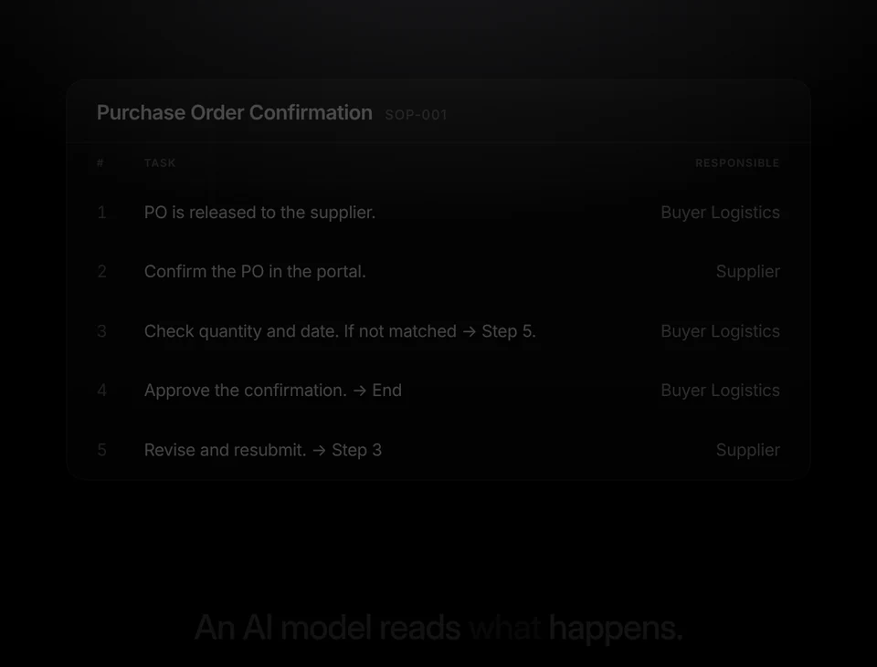
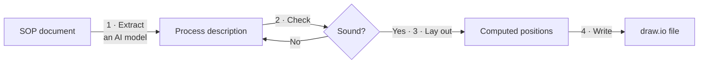

# swimlane-builder

**Turn an SOP (standard operating procedure) into a clean draw.io swimlane diagram.**

  

  <a href="docs/media/swimlane-builder-showreel.mp4"><b>▶ Watch the 30-second overview</b></a> (with sound)
  &nbsp;·&nbsp;
  <a href="https://github.com/Andy-playground/Swimlane-builder/releases/latest"><b>Download the latest release</b></a>
  &nbsp;·&nbsp;
  <a href="docs/OVERVIEW.md"><b>中文說明</b></a>

## What it is

swimlane-builder draws the flowchart that belongs to a written procedure. You give it an SOP —
a process table, a numbered step list, a Word document — and get back a swimlane diagram you
can open and share in [draw.io / diagrams.net](https://app.diagrams.net): one horizontal lane
per role or system, the steps laid out left to right, decisions branching, rework loops
pointing back.

Nobody drags boxes. An AI model reads the SOP and writes down *what* happens: who does each
step, where the flow branches, which steps loop back. A plain program then works out *where*
everything goes: which column a step sits in, how tall each lane is, how wide each box is, and
the path of every line.

## Why it exists

Diagrams drawn by hand have three problems that get worse with every SOP a team maintains:

- **Two people draw the same procedure differently.** A set of SOPs ends up with as many
  visual styles as it has authors.
- **A small change means a big redraw.** Adding one step in the middle pushes everything after
  it, so diagrams stop being updated.
- **The diagram and the text drift apart.** Nothing checks that the picture still says what
  the document says.

swimlane-builder takes the drawing out of people's hands. People decide what the process is;
the layout is computed, the same way every time.

## What you get

- **A diagram with no hand-placed geometry.** Boxes are sized to fit their text, lines run
  through the free space between boxes and never cut through one, and labels are placed where
  they cover nothing. Where that is not possible, the tool tells you.
- **The same result every time.** One input produces exactly the same file, down to the byte.
  A diagram can be kept in version control and regenerated whenever the SOP changes, and a
  change in the picture always traces back to a change in the process.
- **A check on the process itself.** Before drawing, the tool reports steps nothing leads to,
  decisions with only one way out, loops nobody declared, and labels too long to read. See the
  [list of messages](docs/CODES.md).
- **One visual standard for many SOPs.** Colors, fonts and spacing live in a theme. A whole
  folder of procedures can be generated in one run, and switching the theme restyles all of
  them. Two themes are included: draw.io pastels, and plain black-and-white.
- **An ordinary draw.io file.** No plugin or account is needed to open it, and the diagram
  carries a legend, the SOP's own step numbers, and separate line styles for offline, system
  and user interactions.
- **Nothing to install, nothing sent anywhere.** The generator needs only Python 3.11 or
  later. It uses no AI and no network; only the reading of the SOP involves an AI model, and
  you choose which one.

## Where it fits

It works well when:

- your procedures are written as steps with an owner each, especially process tables with a
  Responsible column and "go to step N" pointers;
- you maintain many SOPs and want them to look like one family;
- SOPs change often and the diagrams have to keep up;
- you want diagrams reviewed and versioned like documents, where a difference means something;
- you already work with an AI assistant and want it to return a finished diagram from a
  document.

It is the wrong tool when:

- you want to arrange a diagram by hand, or fine-tune one after it is generated. Changes are
  made to the process description and the diagram is regenerated; hand edits are lost;
- you need something other than a swimlane flowchart, such as full BPMN, an org chart or an
  architecture diagram;
- the procedure is one very long flow. Past about 14 columns the diagram no longer fits a
  laptop screen at a readable size. The tool says so, and splitting the SOP is up to you.

## How it works

1. **Extract.** An AI model reads the SOP and writes a short, structured description of the
   process: the lanes, the steps, and how they connect. This is the only step that has to
   understand natural language. It is told never to invent a step the document does not state;
   anything unclear is marked for you to resolve.
2. **Check.** The description is tested for mistakes. Errors stop here with a message that
   says what to fix; warnings are advice and do not stop the diagram.
3. **Lay out.** Pure geometry. Columns follow the order of the flow, boxes grow with their
   text, and the corridors between boxes widen to hold the lines that pass through them.
4. **Write.** The computed positions are written out as a draw.io file.

Steps 2 to 4 are an ordinary program, which is why the result is repeatable.

## How to use it

There are two ways in, and the [usage guide](docs/USAGE.md) covers both step by step.

- **Through an AI assistant.** The repository is packaged as a Skill. Add it to Claude, or to
  any assistant that can read files and run Python, hand over an SOP as text or `.docx`, review
  the summary of what it understood, and receive the diagram. The package is on the
  [releases page](https://github.com/Andy-playground/Swimlane-builder/releases/latest).
- **From the command line.** Have any AI model produce the process description using the
  included instructions, then run the generator on it, for one file or for a whole folder.

To see a result before trying it, open one of the examples below in draw.io.

## Examples

Each example is a process description with its generated diagram next to it. The process
content is fictional.

| Example | What it shows |
|---|---|
| [Purchase order confirmation](examples/po-confirmation.drawio) | The smallest useful flow: three lanes, one decision, one rework loop |
| [Special order shipment](examples/special-order-shipment.drawio) | 13 steps with documents, a sub-process, and all three line styles |
| [Booking change](examples/booking-change.drawio) | 17 steps and seven decisions, with branches that are not just Yes/No |
| [Delivery dates](examples/delivery-dates.drawio) | A wide flow of 15 columns with exception steps and long decision questions |

## Known limitations

- A long label on a start or end circle can spill outside the circle, and nothing warns about
  it yet.
- Wide flows, from roughly 14 columns, do not fit one laptop screen at a readable size. A
  warning reports it; the tool never reshapes a flow to make it fit.
- The two branches leaving a decision can cross each other near the decision when one branch
  travels further than the other.
- A label on a very short line can overlap the shapes around it. A warning reports it.
- An arrow entering a document shape from below stops just under the shape's wavy bottom edge.

## Documentation

| Document | For |
|---|---|
| [Usage guide](docs/USAGE.md) | Running the tool, the process description format, themes |
| [Messages](docs/CODES.md) | What each error and warning means and what to do about it |
| [Development](docs/DEVELOPMENT.md) | Code layout, tests, and the rules that keep output stable |
| [中文說明](docs/OVERVIEW.md) · [錯誤碼白話表](docs/CODES-zh.md) | 中文版的介紹、術語對照與錯誤碼 |

## License

[MIT](LICENSE) © 2026 Andy-playground
