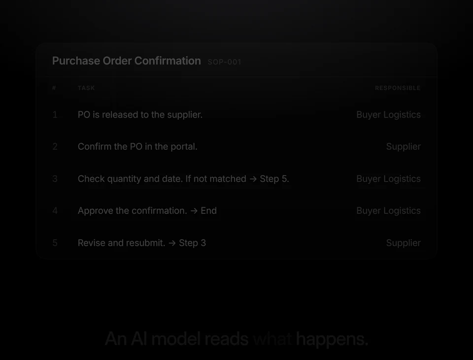

# swimlane-builder

**Turn a supply chain SOP into a swimlane diagram in minutes, not an afternoon.**

Hand your AI assistant a process table or a written procedure. You get back a draw.io file
with the lanes sized, the boxes placed and the lines routed. It is a strong first draft, not
a finished drawing: you open it in draw.io and adjust whatever you would have done
differently.

  

  <a href="docs/media/swimlane-builder-showreel.mp4"><b>▶ 30-second overview</b></a> (with sound)
  &nbsp;·&nbsp;
  <a href="https://github.com/Andy-playground/Swimlane-builder/releases/latest"><b>Download the Skill</b></a>
  &nbsp;·&nbsp;
  <a href="docs/OVERVIEW.md"><b>中文說明</b></a>

## Why I built it

I work with supply chain procedures: purchase orders, bookings, shipments, delivery dates.
Drawing one of them as a swimlane used to take me three to four hours, and most of that
time went into dragging lines and re-arranging boxes every time a step moved.

With this tool the first draft takes about five minutes. In my experience roughly nine
parts in ten are right as generated, and the rest is a few touch-ups in draw.io. That is
why the output is a `.drawio` file and not a picture: the last part is yours to finish.

## Works with

| | |
|---|---|
| **To make a diagram** | Claude, with the Skill added · any AI agent that can read files and run Python · any LLM plus the command line |
| **To open and edit the result** | [draw.io / diagrams.net](https://app.diagrams.net) on the web or desktop, and anything else that imports `.drawio` files |
| **To run it** | Python 3.11 or later, with no extra packages. Your AI assistant needs its usual connection to read the SOP; the layout step itself makes no network calls |

Mermaid, SVG and Visio output are planned.

## How to use it

Describe the process to your AI assistant and ask for a swimlane diagram. It shows you a short
summary of what it understood, you confirm or correct it, and you get the `.drawio` file.

What you can hand over:

- **A RACI matrix or process table (best).** Parties, steps and tools are stated outright, so
  little has to be guessed.
- **A written procedure.** A numbered step list or an SOP, as text or `.docx`.
- **A paragraph or meeting notes.** A description of who does what, or the record of the
  meeting where the process was agreed. Sorting that into steps is what language models are
  good at.

The assistant is instructed to ask when your source is unclear, and to mark a step it is
unsure of as `TODO` so you can see it. It can still misread a document, which is what the
summary is for: check it before you accept the diagram.

There are two ways to change a diagram. Tell the assistant what changed and it draws a new
one, or edit the file in draw.io yourself. Drawing a new one does not keep edits you made by
hand, so make those last. Step-by-step instructions for the Skill and the command line are in
the [usage guide](docs/USAGE.md).

## What it does for you

Every tool can draw lanes, boxes and arrows. This one takes over the parts that eat the
afternoon.

**Layout**

- Boxes grow to fit their text, and lanes grow to fit their boxes.
- The flow reads from left to right, with side branches placed around it.
- The page size is picked to fit the diagram.

**Lines**

- Lines go around boxes and do not cut through them.
- Lines do not sit on top of each other. When several go the same way, they run side by
  side.
- It tries different arrangements to cut down on crossed lines: where several lines leave
  one side of a box, and which way the Yes and the No leave a decision. A simple flow often
  ends up with none. A busy one will still have some.
- An arrow that sends work back to an earlier step runs around the outside, so it is easy to
  spot.
- Line styles show how a handover happens: system to system, a person using a system, or
  offline (email, phone).

**Labels and annotations**

- "Yes" and "No" labels are placed next to their own arrow, clear of boxes and other lines.
  When a label has no clear spot, it is still drawn and you get a warning.
- Each box shows the step number from your document, so you can match the diagram to the
  text.
- A legend is added automatically.

**Checks before drawing**

- It finds gaps in the process before drawing. For example: a step that no arrow leads to,
  or a yes/no question that only has a "yes" path.
- It warns you when the diagram is too wide to read on a laptop screen.

**Consistency**

- The same steps always give the same diagram. The drawing is done by a program and not by
  the AI model, so nothing shifts between runs unless the process description did.
- All your diagrams share one look. Colors, fonts and spacing come from a theme, and two
  themes are included.
- A whole folder of procedures can be drawn in one run.

## What it does not do yet

- It does not remove every crossing. The busiest example here, with seven decisions, still
  has 14.
- A flow wider than about 14 columns does not fit one laptop screen at a readable size. You
  get a warning; the flow is not reshaped for you.
- Edits you make in draw.io are not carried into a regenerated diagram.

The full list is under [known limitations](docs/USAGE.md#known-limitations).

## Examples

Open any of these in draw.io to see a result. The process content is fictional.

| Example | What it shows |
|---|---|
| [Purchase order confirmation](examples/po-confirmation.drawio) | The smallest useful flow: three lanes, one decision, one rework loop |
| [Special order shipment](examples/special-order-shipment.drawio) | 13 steps with documents, a sub-process, and all three line styles |
| [Booking change](examples/booking-change.drawio) | 17 steps and seven decisions, with branches that are not just Yes/No |
| [Delivery dates](examples/delivery-dates.drawio) | A wide flow of 15 columns with exception steps and long decision questions |

## Documentation

| Document | For |
|---|---|
| [Usage guide](docs/USAGE.md) | Running the tool, the input format, themes, where it fits, known limitations |
| [Messages](docs/CODES.md) | What each error and warning means and what to do about it |
| [Development](docs/DEVELOPMENT.md) | Code layout, tests, and the rules that keep output stable |
| [中文說明](docs/OVERVIEW.md) · [錯誤碼白話表](docs/CODES-zh.md) | 中文版的介紹、術語對照與錯誤碼 |

## License

[MIT](LICENSE) © 2026 Andy-playground
